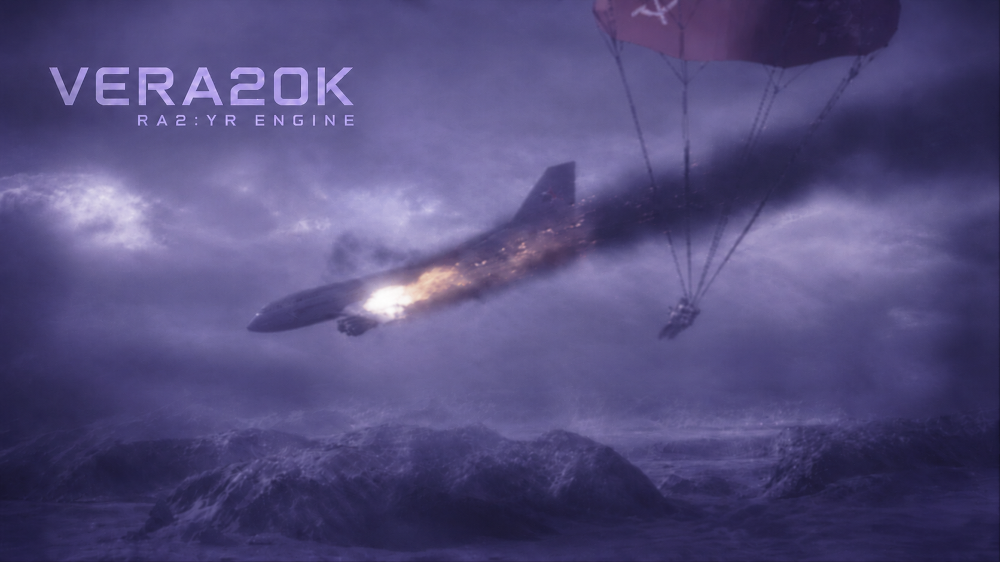

<p align="center" dir="ltr">
  <a href="README.sv.md" lang="sv">Svenska</a> · <strong>简体中文</strong> · <a href="README.de.md" lang="de">Deutsch</a> · <a href="README.ar.md" lang="ar" dir="rtl">العربية</a> · <a href="README.es.md" lang="es">Español</a> · <a href="README.ja.md" lang="ja">日本語</a> · <a href="README.ru.md" lang="ru">Русский</a> · <a href="README.th.md" lang="th">ไทย</a> · <a href="README.tr.md" lang="tr">Türkçe</a> · <a href="README.md" lang="en">English</a>
</p>
<p align="center" dir="ltr">
  <a href="https://github.com/YuriPlanet/vera20k/actions/workflows/macos.yml?query=branch%3Amain" title="最近一次手动运行的 macOS 库测试"></a>
  <a href="https://github.com/YuriPlanet/vera20k/actions/workflows/linux.yml?query=branch%3Amain" title="最近一次手动运行的 Linux 库测试"></a>
  <a href="https://github.com/YuriPlanet/vera20k/actions/workflows/windows.yml?query=branch%3Amain" title="最近一次手动运行的 Windows 库测试"></a>
  <a href="https://discord.gg/kmjRUn5m5F"></a>
  
</p>

# VERA20K

VERA20K 是一个由社区主导、对原版引擎 `gamemd.exe` 进行重写的项目。它使用原版游戏文件，因此你需要自行准备一份《红色警戒2：尤里的复仇》。

本 README 同时是 **VMCE（VERA Multiplayer Campaign Expansion，VERA 多人战役扩展）** 的玩家和地图作者指南。VMCE 不是运行时的 INI 开关，而是由 Cargo 特性 `vmce` 在编译时决定是否加入。

```bash
# 开发构建，带 VMCE：
cargo build --profile fast --features vmce --bin vera20k

# 最小发布构建，带 VMCE：
cargo build --release --no-default-features --features vmce --bin vera20k
```

不带 `--features vmce` 时，VMCE 模式行不会注册，也不会扫描 VMCE 战役目录；普通遭遇战、原版战役和原版 Cooperative 模式不受影响。


## 编译特性

和可选的 Ares、Phobos、VeraX 能力一样，VMCE 是显式开启的编译特性；默认构建和发布构建都不带。

| 特性 | 默认 | 启用内容 |
|---|---|---|
| `vmce` | 关 | `Multiplayer Campaign` 模式、`Maps/VMCE` 系列发现、VMCE 角色和结果流程 |
| `ares` | 关 | 已支持的 Ares 扩展 |
| `phobos` | 关 | 已支持的 Phobos 扩展 |
| `npatch` | 关 | NPatch 扩展能力（占位） |
| `verax` | 关 | VERA20K 自有第一方扩展链 |
| `npbug` | 关 | NPExt bug 修复能力 |
| `dev-overlays` | 开发构建默认开 | Ctrl+Shift 诊断覆盖层和开发存档功能 |

发布工作流使用 `--no-default-features`。需要把 VMCE 放进发布包时，显式加上 `--features vmce` 重新构建。

## 安装

1. 安装一个带 `--features vmce` 的 VERA20K 构建。
2. 按 VERA20K 的常规方式准备原版《尤里的复仇》文件。VMCE 不附带、也不再分发 EA 游戏数据。
3. 把每个战役系列放到：

```text
<VERA20K 设置目录>/Maps/VMCE/<系列>/
├── campaign.ini
├── ra2md.csf          可选；本系列使用的 CSF
├── all01umd.map
├── all02umd.map
└── ...
```

`Maps/VMCE` 的每个直接子目录就是一个系列战役。`campaign.ini`、地图和系列 CSF 都放在该目录内；`Entry`、`Scenario1..ScenarioN`、`NextScenario` 相对系列目录，不要再写系列名。

VMCE 现在只读 `Maps/VMCE`。旧的 `Maps/VeraCampaign` 和过渡版 `Maps/Vmce` 目录不再读取；把每个系列目录整体移到 `Maps/VMCE/<系列>/` 即可。

地图必须是松散 `.map` 文件，同一张地图不能属于两个系列。LAN 两端必须安装相同的系列目录、`campaign.ini`、系列 CSF 和当前所选地图的字节；VMCE 不传输文件。

### 系列名来自 CSF

`[Campaign] Name=` 可选，值是 CSF 标签，不是字面文本：

```ini
[Campaign]
Name=Name:AD03
Entry=all01umd.map
ScenarioCount=2
Scenario1=all01umd.map
Scenario2=all02umd.map
```

解析顺序：

1. 系列目录自己的 `ra2md.csf`；
2. 基础游戏 CSF；
3. 系列目录名。

例如 `Name:AD03` 会从林德拉克计划包的 CSF 解析为「林德拉克计划」；标签缺失时回退目录名。

## 启动一局

1. 所有玩家安装同一份 `Maps/VMCE/<系列>/` 内容。
2. 进入 LAN 房间，选择 **Multiplayer Campaign** 模式行。
3. 房主选图；客人必须看到地图可用（Ready）。
4. 每名玩家确认角色并准备；房主开始。
5. 任务使用同一份确定性共享世界；两端必须看到相同的开局、触发器和结果。

VMCE 只支持 LAN。WOL、CnCNet、在线匹配、任务中途加入和中途重连都不支持。

## 角色与 House

每个玩家角色对应地图中的一条主 House：

- `campaign.ini` 的 `Player1..PlayerN` 选择主 House。
- `PlayerCount` 是本关角色数，不要设得比实际参战人数高。
- 共享 House（例如 `French House`）由 `[Scenario:<地图>:<House>]` 的 `PlayerNControl=yes` 授权给角色。共享 House 不会在结果页单独占一行。
- `PlayerControl=yes` 是 `Player1Control=yes` 的旧写法。多个角色控制同一条 House 时，请显式写 `Player1Control=yes`、`Player2Control=yes`……
- 地图里直接标 `PlayerControl=yes` 的原版主 House 不会自动交给 VMCE 角色。若它应由玩家控制，请在 `campaign.ini` 加对应的 `PlayerNControl=yes`，否则保持 AI。

VMCE 不按遭遇战出生点给角色分配基地。地图作者要为每个角色预置基地和单位，或用触发动作生成；VMCE 不会发基地车或建造厂。

## campaign.ini 参考

`[Campaign]`：

| 键 | 类型 | 默认 | 说明 |
|---|---|---|---|
| `Name` | CSF 标签 | 系列目录名 | 大厅显示的系列名 |
| `Entry` | 地图路径 | 必填 | 第一关；必须在 `Scenario1..ScenarioCount` 中，相对系列目录 |
| `ScenarioCount` | 整数 `1..512` | 必填 | 系列列出的关卡数 |
| `Scenario1..ScenarioN` | 地图路径 | 必填 | 相对系列目录的松散 `.map` 路径；不能重复 |

`[Scenario:<地图路径>]`：

| 键 | 类型 | 默认 | 说明 |
|---|---|---|---|
| `PlayerCount` | 整数 `1..4` | `0`（非法） | 本关玩家角色数 |
| `Player1..PlayerN` | House 名称 | 必填 | 必须出现在地图 `[Houses]` 中；角色 House 必须互不相同 |
| `NextScenario` | 地图路径 | 空 | 胜利后的下一关；必须在 `ScenarioCount` 中 |
| `AltNextScenario` | 地图路径 | 空 | 目前只校验，尚未执行 |
| `EndOfGame` | 布尔 | 空 | `yes` 表示战役末关，结果页不提供 Continue |

`[Scenario:<地图路径>:<House 名称>]`：

| 键 | 类型 | 默认 | 说明 |
|---|---|---|---|
| `Player1Control..Player4Control` | 布尔 | 空 | `yes` 表示该角色可以控制这条共享 House |
| `PlayerControl` | 布尔 | 空 | 旧字段；没有写 `PlayerNControl` 时等价于 `Player1Control` |

未知键、重复段/重复键、超出 `PlayerCount` 的 `PlayerN`、空白必填值和越界路径都会被拒绝。`campaign.ini` 上限 64 KiB。所有 `ScenarioN` 地图必须本地存在，即使本局只玩第一关。

## 任务规则

- 所有玩家运行同一个确定性世界；命令进入同一模拟帧。
- 初始同盟和共享视野由地图 `[Houses]` 的 `Allies=` 图决定；请把所有角色 House 互相写进 `Allies=`。
- 单个角色主 House 被打光不会自动结束任务；胜负只来自地图触发器的结局动作。
- 镜头、EVA、文字和输入锁默认作用于所有玩家；VMCE 不按角色过滤。
- 黑幕重置（动作 51）和雷达中断（动作 139）是 House 私有状态；需要全队效果时，为每个角色各写一条。
- LAN 大厅难度选择触发器难度列：Easy/Medium/Hard；不改单位属性、AI 难度或经济。难度在开局时冻结。

## 结局动作

| 动作 | 名称 | VMCE 行为 |
|---|---|---|
| `1` | 胜利者是某国 | 全队胜利；VMCE 忽略国家参数 |
| `2` | 失败者是某国 | 全队失败；VMCE 忽略国家参数 |
| `67` | 宣告胜利 | 全队立即胜利 |
| `68` | 宣告失败 | 全队立即失败 |
| `69` | 结束任务 | 有先前结果时恢复结果计时；否则按胜利处理 |

新地图请使用 `67`/`68`；`1`/`2` 的原版国家参数不会按角色过滤。

不要依赖单个主 House 全灭来结束任务；VMCE 没有「所有角色都失败」的自动兜底。

## 结果页与继续

- BC6 结果页每个角色主 House 一行，并显示任务时间。
- 胜利且存在下一关时：房主自动 ready，客人按 Continue 表示 ready；全员 ready 后只有房主能进入下一关。
- 下一关会按同一份 `campaign.ini` 和角色映射重新校验。
- 失败、`EndOfGame=yes` 或没有 `NextScenario` 时没有 Continue，只能退出。
- VMCE 不写 `coopsave.ini`，也不保存跨关进度。

## 地图作者注意事项

- 每个角色主 House 必须使用不同的 `Country`。触发器 owner 和事件/动作里的国家参数解析到 Country；同一 Country 的第一条 House 会胜出。
- 角色条件按角色各写一份触发器，不要指望引擎自动复制或聚合。
- 地图可以在 `[Countries]`/`[Colors]` 注册自定义国家；`Side` 必须已在规则 `[Sides]` 中。VMCE 不合并地图新增的 `[Sides]`。
- 不要用 `<Player @ X>` 选择器、`<random>`/`<none>` 作为角色 owner、动作 15 `AllowWin` 或事件 33 做角色逻辑；请用国家 selector 和 `67`/`68`。
- 增援小队、TaskForce 和基地车不会自动按角色复制；每个角色需要时各写一份。
- AI 专用动作作用在角色 House 上通常无效，因为 VMCE 把角色 House 标为人类控制。

## 当前限制

- 只支持 LAN；不支持 WOL、CnCNet、在线匹配。
- 不支持任务内存档/读档。
- 玩家掉线后不接管 AI；不支持中途加入和房主迁移。
- 不继承跨关资金、seed、角色重选或持久进度。
- `AltNextScenario`、`SkipMapSelect`、`EndOfGame` 战役完成页和失败重试未实现。
- 结构上支持 3–4 名玩家；结果页原生布局目前主要按两行验收。
- VMCE 是可选特性；不带 `--features vmce` 的构建没有 VMCE 模式行。

## 故障排查

- **没有 Multiplayer Campaign 模式行**：使用 `--features vmce` 重新构建。
- **地图不出现在大厅**：检查 `Maps/VMCE/<系列>/campaign.ini`；`Entry` 必须在 `Scenario1..ScenarioN` 中；地图必须是松散 `.map`；查看以 `ignoring invalid VMCE series` 开头的日志。
- **客人不能 Ready**：客人缺少相同的系列目录、`campaign.ini`、系列 CSF 或当前地图字节。VMCE 不传输文件。
- **角色 House 找不到**：`PlayerN` 必须与地图 `[Houses]` 中的名称一致。
- **第二个角色的触发器不生效**：给每个角色 House 不同的 `Country`，并各写一份触发器。
- **打光一个角色任务还在继续**：这是预期行为；VMCE 不自动判负，请写 `67`/`68` 触发器。
- **开局没有基地**：VMCE 不发放 MCV 或建造厂；请预置或用触发动作生成。

## 开发

引擎贡献流程见 [AGENTS.md](AGENTS.md)。

```bash
cargo test -p vera20k --lib --features vmce
cargo test -p vera20k-core --lib --features vmce
cargo build --profile fast --features vmce --bin vera20k
```

完整中文说明（含触发器、动作和地图作者细节）在
[docs/zh-CN/veramultiplayer-campaign-expansion.md](docs/zh-CN/veramultiplayer-campaign-expansion.md)。
其他引擎文档：[Ares](docs/ares.md)、[Phobos](docs/phobos.md)、[NPatch](docs/npatch.md)、
[VeraX](docs/verax.md)、[引擎概览](docs/index.md)、[开发工具](tools/README.md)、
[Ghidra 工作流](docs/ghidra-workflow.md)。

## 参与贡献

欢迎任何形式的帮助，以下方向最需要人手。每一项都链接到它在路线图中的页面，里面有正在进行的工作和下一步：

- **[玩法与战斗](https://github.com/YuriPlanet/vera20k/issues/3830)：** 单位行为、伤害，以及遭遇战日常运行的稳定性。
- **[性能](https://github.com/YuriPlanet/vera20k/issues/3831)：** 大规模战斗和旧硬件上的帧率与响应速度。
- **[多人模式](https://github.com/YuriPlanet/vera20k/issues/3832)：** 加入、开始和持续进行在线对战，以及合作模式的稳定性。
- **[界面与音频](https://github.com/YuriPlanet/vera20k/issues/3833)：** 菜单、文本、翻译和声音。
- **[战役](https://github.com/YuriPlanet/vera20k/issues/3834)：** 任务已可启动，但要完整打通仍需努力：任务目标、触发器、脚本过场、存档读档和进入下一关。
- **[模组兼容](https://github.com/YuriPlanet/vera20k/issues/3835)：** Ares 和 Phobos 的功能，同时不改变原版游戏的默认行为。
- **[测试](https://github.com/YuriPlanet/vera20k/issues?q=is%3Aopen%20label%3Aparity)：** 对照原版游玩 VERA20K，报告玩起来不一样的地方。

贡献者可以负责引擎的某些部分，并有很大的自由度去做推动 VERA20K 发展的改动。

维护者会协助审查、集成和合并。你的贡献会完整保留你的署名。

讨论在 [Discord](https://discord.gg/kmjRUn5m5F) 和 QQ 群（1097193563）进行。

## 架构

引擎分为三个主要部分：

- **模拟层：** 负责游戏状态和逻辑。
- **渲染层：** 为保留原版画面风格而构建的全新 GPU 渲染管线，使用原版游戏资源。
- **应用层：** 处理输入、菜单、音频和平台集成，并连接各个系统。

这种分离有助于保持游戏行为的确定性。

箭头表示数据流向：


所有收到的捐款都将根据
[TIBTRE 贡献账本](https://github.com/YuriPlanet/tibtre-ledger)分配给贡献者。

贡献者收款方式：

<p>     </p>

## 支持

<a href="https://paypal.me/vera20k"></a>

## 致谢与法律

感谢 OpenRA、XCC Mixer、ModEnc wiki、Project Perfect Mod、EA 的 Command & Conquer 与 Red Alert GPL 源码、World-Altering Editor、Final Alert、YRpp、Ares、Phobos 以及许多其他项目。

Copyright © 2026 Halvor Nikolai Rusten and VERA20K contributors.
Licensed under the [GPLv3](LICENSE-GPL) with [additional terms](LEGAL.md#additional-terms).
本仓库不包含游戏文件。Command & Conquer 和 Red Alert 是 Electronic Arts Inc. 的商标；
截图和应用图标（红色警戒2 的红星）包含 Electronic Arts 拥有的游戏美术资源。VERA20K 与
Electronic Arts 没有隶属或认可关系。

**分享、出售或 fork VERA20K 前请阅读[法律声明](LEGAL.md)。**
